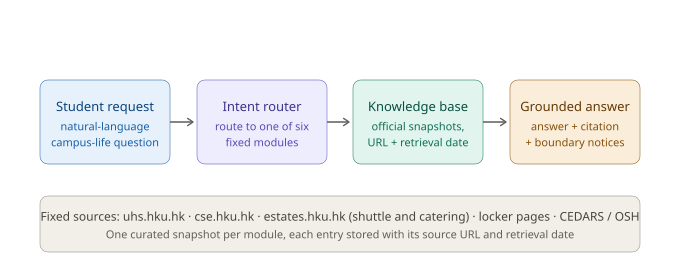

# Enrichment Pal — Project Proposal

*(Team [组号/成员名] · HKU · [课程代码])*

---

## 1. Who is this for?

Enrichment Pal is designed for **HKU students**, with two priority sub-groups:

- **New and incoming students** (Year-1 undergraduates, taught-postgraduate and research students arriving in September), who face the steepest learning curve in discovering campus services;
- **Non-local students** (mainland and international), who additionally face language and system barriers — they are the least likely to know, for example, that the University Health Service (UHS) offers **free general medical consultation** to eligible students, or that sports facilities must be booked **up to 7 days (individual) / 28 days (group) in advance** via the CSE booking system.

The common trait of our target users: they are **entitled to a rich set of university services but do not know these services exist, where to find them, or how to use them**.

## 2. What is stuck?

The information students need to enrich their campus life is **fragmented across many official channels that do not talk to each other**:

- Health: UHS website (consultation hours, fees, appointment steps), CEDARS pages (insurance guidance for non-local students);
- Exercise: CSE facilities pages (venue opening hours, capacity rules, floodlight fees) and a separate booking portal behind HKU Portal login;
- Daily-life services that are just as scattered: the campus shuttle bus timetable (Estates Office), catering outlets and opening hours (Estates Office Catering Services), locker rental (venue-specific official pages, e.g. ITS / Libraries / CEDARS amenities), and student housing (CEDARS / Office of Student Housing).

Each source uses different structures, terminology and update cycles. In practice this causes students to (a) spend significant time searching and cross-checking, (b) **miss booking windows** (e.g. the 7-day advance rule), (c) be unclear about **which medicines are over-the-counter vs. prescription**, and (d) over- or under-use free entitlements such as UHS consultation. Generic chat assistants do not solve this: their answers are not anchored to the university's fixed official sources, so they hallucinate or go stale.

## 3. Why it matters this semester?

- **Timing of the user journey:** September–October is exactly when the pain is worst — new students arrive, add/drop happens, sports-club recruitment and society membership campaigns run, and the flu season approaches. Students are *right now* forming the habits (which clinic to visit, where to book badminton courts, which society to join) that will persist for the whole year.
- **Feasibility of validation:** because the team is on campus, every feature can be validated with real users within days, and every information source is one we can personally verify and cite (uhs.hku.hk, cse.hku.hk, cedars.hku.hk, HKUSU), which satisfies our project constraint that **data sources must be relatively fixed**.
- **A well-bounded semester-sized scope:** six modules (medical, sports facilities, campus shuttle bus, locker rental, dining, student housing), each anchored to a stable official source, is achievable within one semester while leaving clear room for future extension.

## 4. Who or what is it NOT for?

We deliberately draw the following boundaries:

1. **Not an official medical proof.** Enrichment Pal does **not** issue any medical certificate and must not be used to justify deadline extensions, absence, or special consideration in courses. It only helps students *find* official services (e.g. how to book a UHS appointment, where a receipt or medical certificate can legitimately be obtained from UHS staff).
2. **Not for emergencies.** It is not a triage or diagnosis tool. For emergencies it will always direct users to 999 / campus security rather than attempt to advise.
3. **Not a replacement for official systems.** It does not process real bookings or payments; it guides users to and through the official CSE booking portal and UHS appointment system (which require HKU Portal authentication).
4. **Not for users outside HKU,** and not a general-purpose study or coursework assistant — scope discipline is part of the design.

## 5. Where the idea comes from

The project is an **adapted topic-list idea**: we started from the course topic list item *"[填写：课程 topic list 中的对应条目名，如 'campus assistant' / 'student life chatbot']"*, and adapted it substantially:

- **Narrowed and grounded it** to HKU's actual service landscape with six fixed, verifiable official sources (UHS / CSE / Estates Office shuttle bus & catering / locker rental pages / CEDARS housing), rather than an open-ended "campus Q&A bot";
- **Added an ethics-first boundary** (no medical proof, no emergency advice, no system replacement), which the original topic item did not include;
- **Added the fixed-data-source constraint** as a design principle: every answer must trace back to a stable official page, which shapes our architecture (curated knowledge base over live web scraping).

*It is therefore not an original idea in the absolute sense, but a significantly re-scoped and re-constrained adaptation. External ideas we consulted for framing: campus service chatbots at other universities (e.g. library FAQ bots), which informed our decision to keep answers source-anchored.*

---

## 6. End-to-end path: request → method → result

**Input:** a natural-language campus-life question, e.g. *"I have a fever — where can I see a doctor and what does it cost?"*, *"How do I book a badminton court for this weekend?"*, or *"Which canteen is open after 8 pm?"*

**Processing:**
1. **Intent routing** — the request is classified into one of six fixed modules: medical, sports facilities, campus shuttle bus, locker rental, dining, student housing.
2. **Retrieval from a fixed corpus** — the agent looks up the relevant entries in a small curated knowledge base. The corpus is not scraped live: it is one snapshot per module taken from a single official page (uhs.hku.hk, cse.hku.hk, Estates Office shuttle-bus and catering pages, venue locker-rental pages, CEDARS / Office of Student Housing), and every entry stores its **source URL and retrieval date**.
3. **Grounded drafting** — a plain-language answer (hours, fees, booking steps, application procedure) is drafted strictly from the retrieved entries, with two mandatory additions: (a) the cited official passage, and (b) boundary notices where applicable — e.g. no medical proof is issued and bookings must be completed in the official authenticated systems.

**Output:** the answer + the cited official page (URL + retrieval date) + a direct next-step link (e.g. CSE booking portal, UHS web appointment booking).

**What the team will actually build:** a small browser-based Q&A demo over that fixed corpus — a curated knowledge base (JSON/Markdown) plus a lightweight intent-routing and retrieval-response layer. It is **not** an official booking system, **not** a medical service, and **not** a live web scraper.

